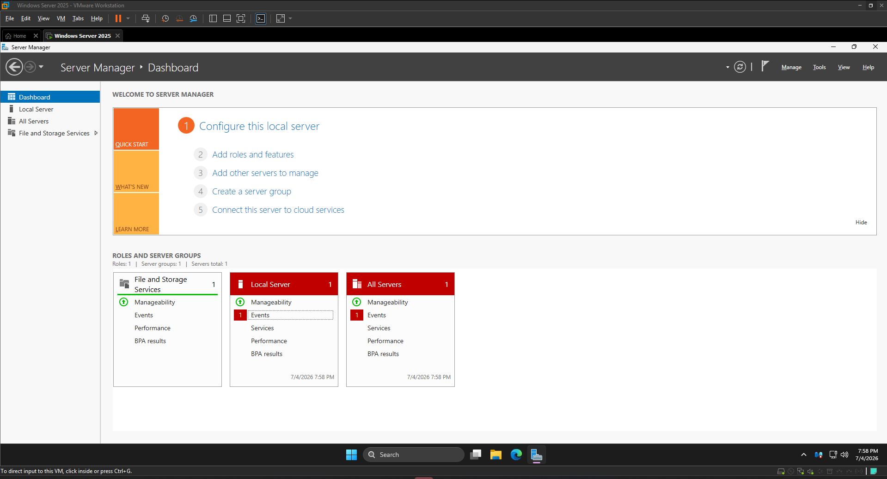
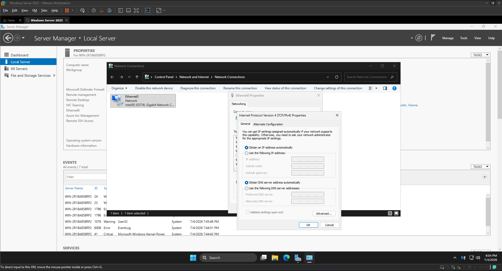
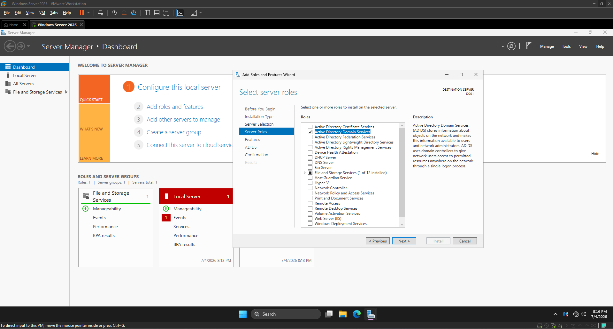
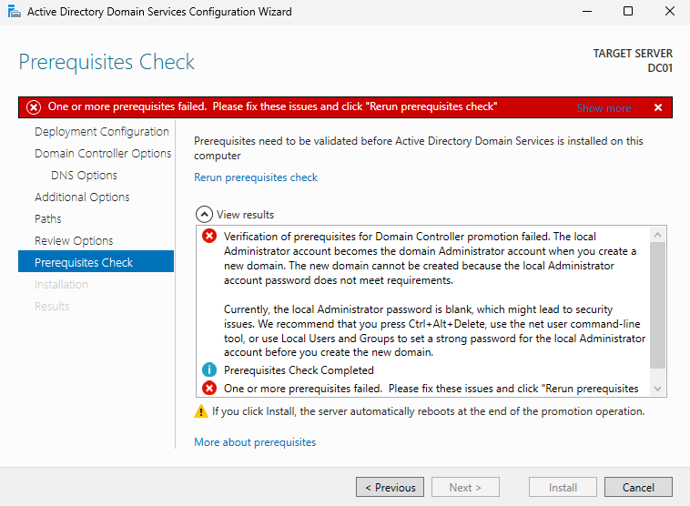
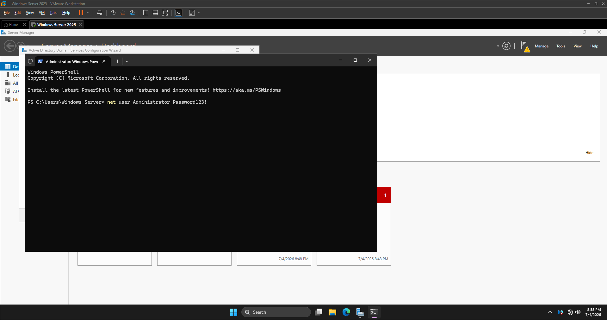
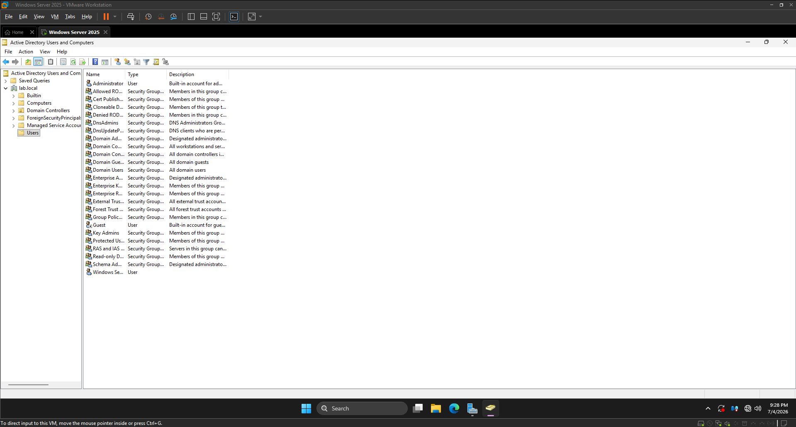

# Mitt Active Directory-labb — Windows Server 2025

I det här projektet installerade jag Windows Server 2025 i VMware och satte upp en egen Active Directory-domän. Jag dokumenterade installationen med skärmbilder, inklusive ett fel som uppstod och hur jag löste det.

## Miljön jag byggde

| Komponent | Det jag använde |
|---|---|
| Virtualisering | VMware |
| Operativsystem | Windows Server 2025 |
| Serveradress | Statisk IP: `10.0.0.1` |
| Serverroll | Active Directory Domain Services |
| Domän | `lab.local` |

## Vad jag gjorde

Först installerade jag Windows Server 2025 som en virtuell maskin. Därefter gav jag servern en statisk IPv4-adress, installerade **Active Directory Domain Services** och konfigurerade servern som domänkontrollant för en ny domän: `lab.local`.

Jag använde **Server Manager** för installationen och **Active Directory Users and Computers** för att kontrollera den färdiga domänen.

## Ett fel jag felsökte

**Problemet:** När jag skulle slutföra konfigurationen av domänkontrollanten fick jag ett fel i förutsättningskontrollen. Installationen gick inte vidare.

**Min undersökning:** Jag läste felmeddelandet. Det visade att det lokala administratörskontot saknade lösenord, vilket behövde åtgärdas innan konfigurationen kunde fortsätta.

**Min åtgärd:** Jag satte ett lösenord på administratörskontot och genomförde kontrollen igen.

**Resultatet:** Konfigurationen kunde slutföras. Efteråt öppnade jag **Active Directory Users and Computers** och såg att `lab.local` hade skapats.

## Vad jag tog med mig

Jag fick praktisk erfarenhet av att installera och konfigurera en domänkontrollant. Framför allt lärde jag mig att inte bara upprepa installationen när något gick fel, utan att läsa felmeddelandet, identifiera orsaken och kontrollera resultatet efter ändringen.

Det är samma typ av arbetssätt jag vill använda inom IT-support: förstå problemet, göra en motiverad ändring och säkerställa att problemet faktiskt är löst.

## Om mina bevis

Skärmbilderna ovan kommer från mitt eget labb. Jag har inte använt produktionsdata eller riktiga supportärenden. Ett äldre dokument visade ett exempel på ett labblösenord; jag har tagit bort det från den aktuella dokumentationen och betraktar det som exponerat om det fortfarande används.
